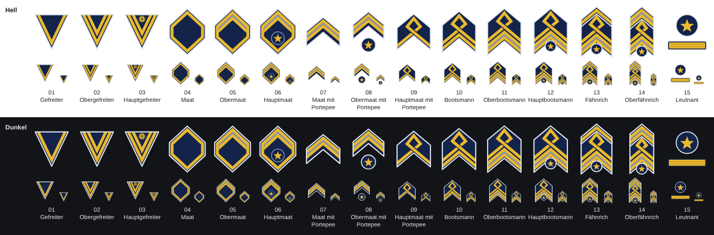
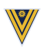
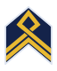
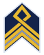
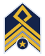
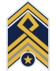
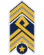

# Abzeichen der Dienstgrade – Icons (SVG)

Stilisierte Abzeichen für die Lanker App (Issue #64, Folge von #48). Vorlage sind die Fotos in
[`../abzeichen-vorlagen/`](../abzeichen-vorlagen/); die Nummern der Dateien sind dieselben.



## Icons

| Nr. | Dienstgrad | Punkte | Icon | Motiv |
|---|---|---|---|---|
| 1 | Gefreiter | 12 |  | Dreieck, ein Winkel |
| 2 | Obergefreiter | 24 |  | Dreieck, zwei Winkel |
| 3 | Hauptgefreiter | 40 |  | Dreieck, zwei Winkel, Rosette |
| 4 | Maat | 70 |  | Raute mit goldenem Rahmen |
| 5 | Obermaat | 90 |  | Raute, oben ein zweites Band |
| 6 | Hauptmaat | 110 |  | wie Obermaat, dazu Stern im Kreis |
| 7 | Maat mit Portepee | 150 |  | Winkel (doppeltes Band) |
| 8 | Obermaat mit Portepee | 170 |  | Winkel (doppeltes Band), Stern |
| 9 | Hauptmaat mit Portepee | 190 |  | Schlaufe |
| 10 | Bootsmann | 230 |  | Schlaufe, ein Winkel |
| 11 | Oberbootsmann | 260 |  | Schlaufe, Winkel mit doppeltem Band |
| 12 | Hauptbootsmann | 300 |  | wie Oberbootsmann, dazu Stern |
| 13 | Fähnrich | 340 |  | wie Hauptbootsmann, oben ein Winkel |
| 14 | Oberfähnrich | 450 |  | wie Hauptbootsmann, oben ein Winkel mit doppeltem Band |
| 15 | Leutnant | 600 |  | Stern und goldener Streifen |
| 16 | Oberleutnant | 750 | – | **noch kein Icon:** Das Foto wird nachgereicht. Bis dahin bleibt der Dienstgrad ohne Abzeichen. |

## Gestaltung

- Zeichenfläche `viewBox="0 0 64 80"` bei allen Icons, transparenter Hintergrund.
- Gold (`#e8b931`) auf Marineblau (`#14234a`); der hellblaue Mittelstreifen der doppelten Bänder ist `#8597c4`.
- Jede blaue Grundfläche hat einen hellen Rand (`#dfe6f2`, 1,5 Einheiten). Auf hellem Hintergrund wirkt die
  blaue Fläche, im Dunkelmodus der helle Rand. Die App setzt keinen eigenen Hintergrund (#48).
- Einheitliche Maße: Goldband 4,5 Einheiten, Abstand 2, Mittelstreifen 2. Alle Winkel der Portepee-,
  Bootsmann- und Fähnrich-Abzeichen haben dieselbe Neigung (40°).
- Hoch zusammengesetzte Abzeichen (13, 14) sind schmaler, damit sie in die gleiche Höhe passen; Strichstärken bleiben gleich.
- Die Position (oben/unten) aus der PDF spielt keine Rolle und ist nicht dargestellt.

## In der App hochladen

Das Hochladen ist ein Schritt von Hand (Spieß oder Admin):

1. **Verwaltung → Dienstgrade** öffnen.
2. Beim Dienstgrad auf **„Abzeichen hochladen“** tippen (ist schon eins da: **„Ersetzen“**) und die passende
   SVG-Datei aus diesem Ordner wählen.
3. Die Vorschau zeigt das Abzeichen auf heller und dunkler Fläche nebeneinander.

Beim Hochladen eines SVG erzeugt die App zusätzlich eine PNG-Fassung für Push-Nachrichten.

## Prüfung durch den SvgSanitizer

Alle Dateien enthalten nur Elemente und Attribute aus der Positivliste des Kerns (`SvgSanitizer`):
keine Skripte, keine Verweise nach außen (nur `url(#…)` auf einen Clip-Pfad in derselben Datei),
keine eingebetteten Rasterbilder, keine Ereignis-Attribute, keine Kommentare. Geprüft wurde, dass der
`SvgSanitizer` jede Datei annimmt und unverändert lässt (kanonisches XML vor und nach der Bereinigung identisch).

## Icons neu erzeugen

Die SVGs werden mit [`erzeugen.py`](erzeugen.py) erzeugt (Python 3, ohne weitere Pakete):

```sh
python3 docs/abzeichen-icons/erzeugen.py docs/abzeichen-icons
```

Für den Oberleutnant wird dort ein weiterer Eintrag ergänzt, sobald das Foto vorliegt.
