# Abzeichen der Dienstgrade – Fotovorlagen

Fotos der Uniform-Abzeichen, extrahiert aus `Marine_Abzeichen.pdf` (Excel-Export, 3 Seiten).
Sie dienen als **Vorlage**: Für die App werden daraus stilisierte Icons (SVG, transparenter
Hintergrund) erstellt, siehe Issue #48. Die Fotos selbst werden nicht in der App verwendet. Die fertigen Icons liegen in
[`../abzeichen-icons/`](../abzeichen-icons/) (Issue #64).

Punkte, Position und Bestand sind aus der PDF übernommen. Das Foto eines einzelnen Winkels in der unbeschrifteten Spalte neben „Hauptmaat“ gehört nicht dazu und wurde nicht übernommen. In der PDF steht „Portopee“; richtig ist „Portepee“.

| Nr. | Dienstgrad | Punkte | Position | Bestand | Foto |
|---|---|---|---|---|---|
| 1 | Gefreiter | 12 | Oben | 10 | 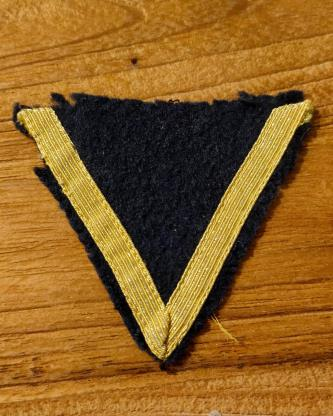 |
| 2 | Obergefreiter | 24 | Oben | 10 | 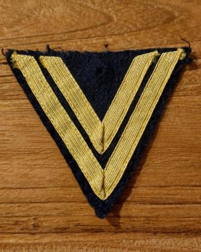 |
| 3 | Hauptgefreiter | 40 | Oben | 7 | 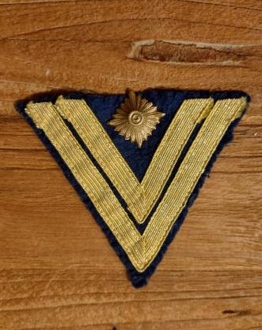 |
| 4 | Maat | 70 | Oben | 8 | 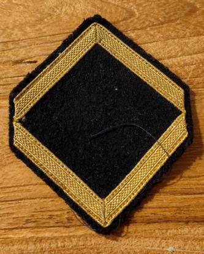 |
| 5 | Obermaat | 90 | Oben | 11 | 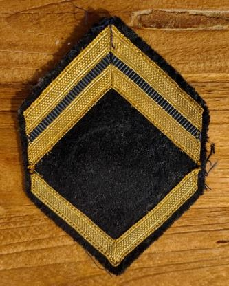 |
| 6 | Hauptmaat | 110 | Unten | 1 | 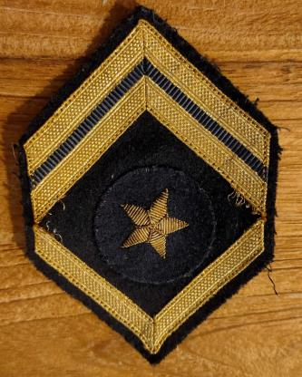 |
| 7 | Maat mit Portepee | 150 | Unten | 3 | 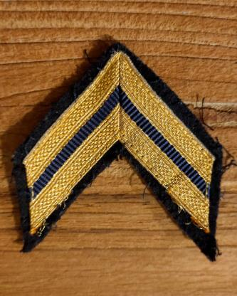 |
| 8 | Obermaat mit Portepee | 170 | Unten | 3 | 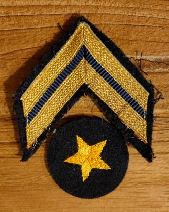 |
| 9 | Hauptmaat mit Portepee | 190 | Unten | 17 | 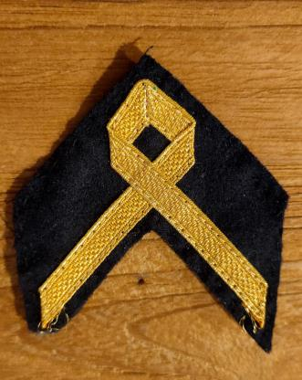 |
| 10 | Bootsmann | 230 | Unten | 24 | 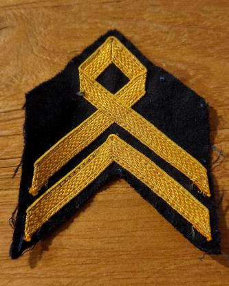 |
| 11 | Oberbootsmann | 260 | Unten | 8 | 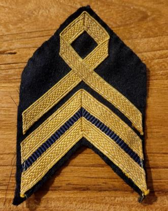 |
| 12 | Hauptbootsmann | 300 | Unten | 8 | 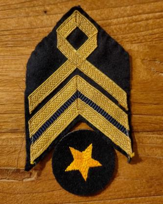 |
| 13 | Fähnrich | 340 | Unten | 8 | 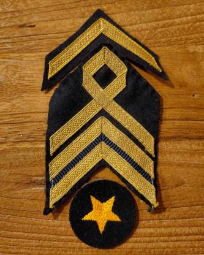 |
| 14 | Oberfähnrich | 450 | Unten | 8 | 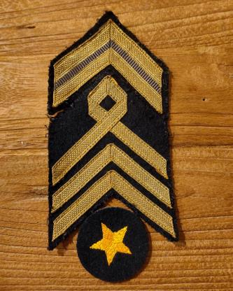 |
| 15 | Leutnant | 600 | Unten | 4 | 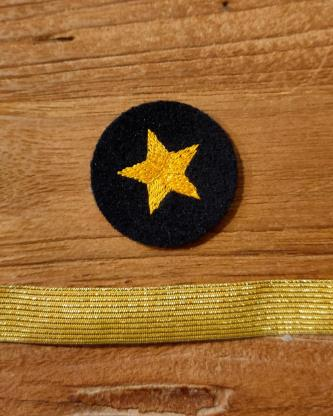 |
| 16 | Oberleutnant | 750 | Unten | x | – kein Foto in der PDF – |
